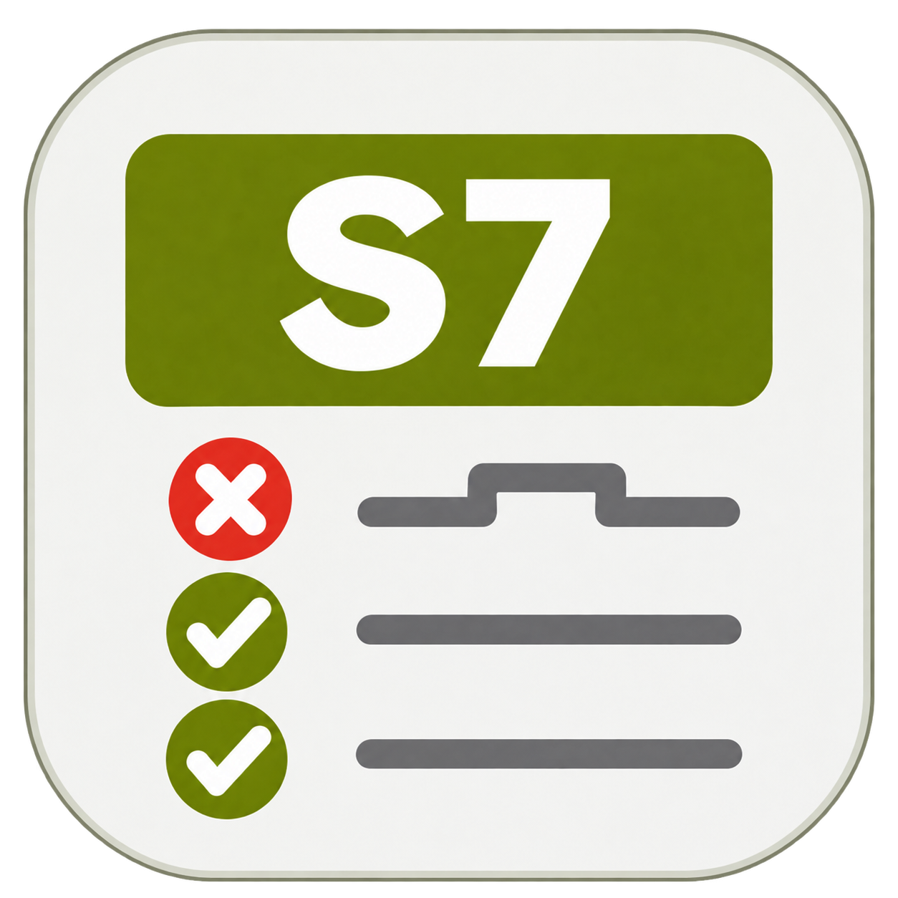
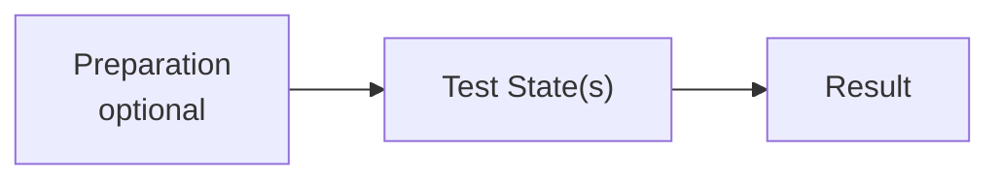

  

<h1 align="center">S7 UnitTest</h1>

  <strong>Unit testing and behavior analysis framework for Siemens S7.</strong>

  
  
  

**Build repeatable tests for your S7 libraries.** S7 UnitTest is an SCL framework
for testing PLC logic and analyzing its behavior in the PLC runtime.

- **Verify logic and data:** check function results, limits, tolerances, arrays, and text.
- **Analyze cyclic behavior:** observe signal changes, edges, sequences, and stability over defined intervals.
- **Reuse test scenarios:** bind tests to different component instances and parameters, then repeat them after code changes.
- **Use the same tests in development and CI:** [PLCSIM.UnitTest](https://github.com/Lorenz-Software/PLCSIM.UnitTest) provides the WPF workbench for interactive runs and debugging, plus the CLI for automated regression testing.
- **Develop tests with AI assistance:** the optional [authoring skill](#ai-assisted-test-development) helps analyze PLC blocks, select meaningful scenarios, and implement them with S7 UnitTest.

The framework implements the same testing approach as
[TC3 UnitTest](https://github.com/Lorenz-Software/Tc3UnitTest), adapted to Siemens S7
and TIA Portal. Tests execute in the PLC program; the PC application controls runs
and evaluates the published results.

## Framework Overview

- **A Test Case describes one scenario.** Preparations establish its starting conditions; Assertions evaluate its expectations.
- **Suites and Run Control compose the application.** Suites collect related Test Cases, and Run Control coordinates those Suites through the supplied orchestration.
- **A shared Event Buffer connects the tests to the PC.** Framework components publish lifecycle events, findings, and results for the PC application to evaluate.

The [Framework Model](docs/authoring/framework-model.md) describes how these
components cooperate and where each responsibility belongs.

> **Complete API documentation**
>
> The [offline HTML reference](docs/help.md) covers callable framework blocks,
> UDTs, global data areas, and constants, with shared search and linked Authoring
> Guides. Extract the help ZIP and open `index.html`; no TIA session or web server
> is required. The supplied library also supports object help through **Shift+F1**.

## Test Cases

Test Cases support immediate value checks and scenarios spanning many PLC cycles:

- **You define:** starting conditions, stimuli, Assertions, phase completion, and resource cleanup.
- **Framework helpers provide:** lifecycle sequencing, Start/Reset/Abort handling, timeout supervision, result aggregation, and structured event reporting.

| Test scenario | Typical use |
| --- | --- |
| **Static checks** | Evaluate a calculation, value, or data structure. |
| **Single Test State** | Observe one condition over time, such as stable feedback or an edge count. |
| **Multiple Test States** | Apply successive stimuli and evaluate a different expectation in each phase. |

`UnitTestCaseSequencer` handles a single running state;
`UnitTestCaseSequencer_MultiTestState` handles successive test states. Each state
can finish after one evaluation or remain active across the PLC cycles needed for
its observation window. The Case evaluates its Assertions and finalizes its
result using the supplied helpers and integration patterns.

### Preparations

Preparations make the required starting condition part of the test. A reusable
Preparation brings the resource into that condition and reports its status; the
Test Case owns its call and timeout supervision. Repeated runs start from a
defined baseline without depending on a previous test.

### Assertions

Choose typed Assertions for the behavior or data you want to verify:

| Check family | Coverage |
| --- | --- |
| Boolean and numeric | Conditions, comparisons, limits, ranges, tolerances |
| Floating-point classification | Finite values, NaN, infinity; scalar and array checks |
| Bits and masks | Individual flags and bitfield expectations |
| Arrays | Equality, contained values and patterns, unchanged snapshots |
| Text and tokens | Strings, character codes, array/text checks, token patterns and counts |
| Signals and sequences | No-change checks, edges, edge counts, ordered values |
| Time and dates | Durations, calendar values, time of day |

Each check has a name and a retained result, so failed expectations remain
identifiable. The [Assertion guide](docs/authoring/assertions.md#choosing-an-assertion)
helps select the matching family and datatype.

## Test Suites and Run Control

- **Test Suites** collect related Test Cases, schedule their execution, and aggregate their results. `UnitTestSuiteSequencer` supplies the generic Suite lifecycle.
- **Run Control** combines Suites into the complete test application and connects it to external run commands. `UnitTestRunControlSequencer` supplies its lifecycle and command handling.

Both levels use collection **Orchestrators**. Choose **Serial**, **Parallel**, or
**ParallelSlots** to run children in order, overlap independent tests, or arrange
concurrent groups.

You register and cyclically call the children. The framework coordinates their
execution and monitoring; you coordinate shared resource ownership. The
[Suite](docs/authoring/test-suite.md) and [Run Control](docs/authoring/run-control.md)
guides show the complete bindings, including result aggregation and final reporting.

## Event Buffer and PC Integration

- **Standard reporting:** Sequencers emit lifecycle events and Assertions emit findings. The owner integration examples complete result and aggregation reporting with supplied helpers.
- **Independent storage:** Logging components manage the shared Event Buffer and FIFO. Integrate them once through Run Control; individual tests need no PC transport or buffer-management code.
- **Ready-made constructors:** supplied functions create event payloads for triggers, state transitions, results, aggregation, and diagnostics. Normal authoring follows the existing integration patterns instead of constructing a new event protocol.

The companion [PLCSIM.UnitTest](https://github.com/Lorenz-Software/PLCSIM.UnitTest)
application reads and acknowledges the events through its PLCSIM Advanced access
profile and turns them into test results:

- **WPF workbench:** repeat scenarios during library development, inspect failed checks, and follow lifecycle events as an additional debugging workflow.
- **CLI automation:** execute the same PLC tests in CI, with exit codes for the job result and JUnit XML for reporting. The [CI starters](https://github.com/Lorenz-Software/PLCSIM.UnitTest/blob/main/src/PLCSIM.UnitTest.App.Cli/examples/ci/README.md) cover runner preparation and integration.

Authoring examples and integration strategies cover every level, from an
individual Test Case to a complete application with command and Event Buffer wiring.
See the [event architecture](docs/framework-architecture.md#events-and-diagnostics)
for reporting responsibilities.

## Example: Testing a Valve Controller

Consider an opening test with two requirements: open feedback must arrive within
**500 ms** and then remain stable for **2 s**. Preparation and two Test States
express that scenario:

| Phase | Scenario logic | Expected observation |
| --- | --- | --- |
| **Preparation** | Establish the closed starting condition. | `ClosedFeedback = TRUE` and `OpenFeedback = FALSE`. |
| **Test State 1** | Set `OpenCommand := TRUE` and measure the response. | `OpenFeedback` becomes TRUE within 500 ms. |
| **Test State 2** | Keep the command active and observe the feedback for 2 s. | `OpenFeedback` remains TRUE throughout the interval. |

The Test Case defines the command sequence and observation windows. Two named
checks, `OpensWithinDeadline` and `OpenFeedbackStable`, distinguish a missed
deadline from feedback that drops out during the hold interval.

- **Reuse the scenario:** bind separate test instances to other valves and timing parameters.
- **Repeat it after changes:** add the Case to a Suite for WPF development runs and CLI regression checks. Results reach the PC application through the shared Event Buffer.

## AI-Assisted Test Development

Use the optional authoring skill with Codex to develop tests using the framework:

- **Understand the subject:** analyze interfaces, relevant dependencies, retained state, and cyclic behavior.
- **Choose useful scenarios:** derive boundary, timing, failure, and recovery checks from requirements, making unclear expectations explicit.
- **Implement agreed tests:** use Assertions, Preparations, and reusable Test Cases with matching lifecycle and call-order guidance.

The package bundles the matching Authoring Guides, contracts, API catalogs,
templates, and general SCL guidance. You review the proposed expectations and
resulting tests; no separately installed Engineering skill is required.

[Download the skill](https://github.com/Lorenz-Software/S7UnitTest/releases/tag/authoring-skill-v1.1.1)
· [Authoring skill](skills/s7unittest-framework-authoring/SKILL.md)
· [Installation and compatibility](docs/authoring/ai-assisted-framework-authoring.md#installation-and-compatibility)

## Project Status

- **Release:** [2.0.0](https://github.com/Lorenz-Software/S7UnitTest/releases/tag/v2.0.0).
- **Downloads:** [native library (.zal21)](https://github.com/Lorenz-Software/S7UnitTest/releases/download/v2.0.0/UnitTest.zal21), [offline HTML help](https://github.com/Lorenz-Software/S7UnitTest/releases/download/v2.0.0/s7-unittest-api-2.0.0.zip), and [object inventory](https://github.com/Lorenz-Software/S7UnitTest/releases/download/v2.0.0/inventory.json) are available with the framework release.
- **Authoring skill:** [1.1.1](https://github.com/Lorenz-Software/S7UnitTest/releases/tag/authoring-skill-v1.1.1), with exact framework compatibility and a complete standalone resource set.
- **Source:** the [TIA project archive](Project/S7_UnitTest.zap21), stored through Git LFS, contains framework implementation and Self-Tests. Use TIA Portal V21 to retrieve it.
- **Library integration:** reusable mastercopies and editable examples; copy the required objects and dependencies, configure the application, and create its instances. See [Library Usage](docs/library-usage.md).
- **Execution scope:** standard non-fail-safe PLC logic in PLCSIM Advanced. F-block testing and functional-safety validation or certification are outside the supported scope. See [Project Use](docs/project-use.md) and [Self-Test coverage](docs/selftest-coverage.md).

## Further Reading

- [Contributing](CONTRIBUTING.md): questions, bug reports, focused changes, and validation expectations.
- [Test Case guide](docs/authoring/test-case.md), [Preparations](docs/authoring/preparation.md), and [Assertions](docs/authoring/assertions.md): implementation examples and check selection.
- [Test Suites](docs/authoring/test-suite.md) and [Run Control](docs/authoring/run-control.md): collections, orchestration, and complete PLC/PC integration.
- [Library usage](docs/library-usage.md), [project use](docs/project-use.md), and [offline HTML help](docs/help.md): consuming the library, opening the project, and reading the API documentation.
- [Architecture](docs/framework-architecture.md), [public contracts](contracts/README.md), and [Self-Test coverage](docs/selftest-coverage.md): design and verification details.
- [AI-assisted authoring](docs/authoring/ai-assisted-framework-authoring.md): block analysis, test planning, and implementation with the framework patterns.
- [SCL import indentation](tools/scl/README.md): the focused helper for preparing source indentation for TIA V21 import.

## Support this project

Sponsorship helps maintain and improve Lorenz Software's open-source PLC testing
frameworks and tools. [Become a sponsor](https://github.com/sponsors/Lorenz-Software).

## License

Created by [Lorenz Software](https://www.lorenz-software.solutions/) and available
under the [MIT license](LICENSE). Contact: [mail@lorenz-software.net](mailto:mail@lorenz-software.net).
